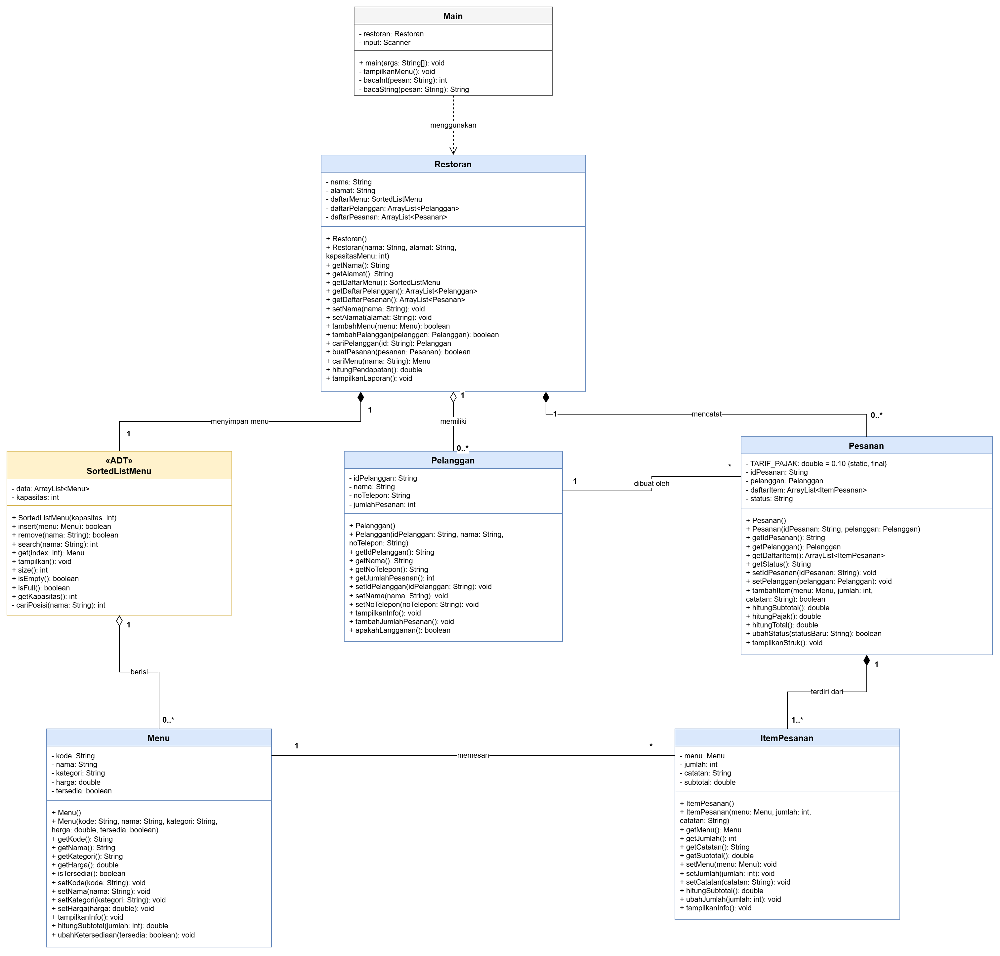

# Rancangan Sistem Manajemen Restoran

## Gambaran sistem

Aplikasi ini berjalan di console dan mencatat tiga hal di sebuah restoran kecil: daftar menu, data pelanggan, dan pesanan. Kasir menambah menu dan pelanggan, membuat pesanan, lalu mencetak struk yang sudah memuat pajak 10 persen. Data tersimpan di memori selama program jalan. Saya tidak memakai database atau GUI.

Pencatatan manual di buku punya tiga masalah: total harga sering salah hitung, menu yang sudah habis tetap tercatat sebagai pesanan, dan pajak dihitung dengan kalkulator setiap kali. Program ini mengerjakan ketiganya dan menolak input yang melanggar aturan dengan pesan yang jelas.

## Class dan alasan pemilihannya

- **Menu**: satu makanan atau minuman, lengkap dengan kode, nama, kategori, harga, dan status tersedia. Restoran menjual menu, jadi menu butuh class sendiri.
- **Pelanggan**: orang yang memesan. Class ini menyimpan ID, nama, nomor telepon, dan jumlah pesanan yang sudah selesai, supaya program tahu siapa yang sudah jadi pelanggan langganan.
- **ItemPesanan**: satu baris dalam pesanan. Pelanggan bisa memesan nasi goreng 2 porsi tanpa pedas dan es teh 3 porsi sekaligus, jadi setiap baris menyimpan menu, jumlah, dan catatannya sendiri.
- **Pesanan**: kumpulan ItemPesanan milik satu pelanggan. Class ini menghitung subtotal, pajak, dan total, dan menjaga status pesanan.
- **Restoran**: pemegang semua data. Restoran menyimpan daftar menu, daftar pelanggan, dan daftar pesanan, lalu menyediakan operasi seperti tambah menu, cari menu, dan laporan pendapatan.
- **SortedListMenu**: ADT Sorted List dengan kapasitas tetap. Daftar menu selalu urut A-Z berdasarkan nama, dan pencarian memakai binary search.
- **Main**: menu console yang menerima input dan menangkap pesan kesalahan, jadi program tidak berhenti saat input salah.

## Aturan bisnis

- Pesanan harus berisi minimal 1 menu sebelum diproses.
- Pajak 10 persen dihitung dari subtotal setiap kali struk dicetak.
- Menu yang statusnya habis tidak bisa dipesan.
- Harga menu harus lebih dari 0.
- Status pesanan berjalan berurutan: BARU, DIPROSES, SELESAI.
- Item tidak bisa ditambah setelah pesanan diproses.
- Nama menu tidak boleh kembar di dalam daftar.
- Daftar menu punya kapasitas tetap, dan insert ditolak saat daftar penuh.
- Nomor telepon pelanggan berupa angka sepanjang 8 sampai 15 digit.
- Pelanggan dianggap langganan setelah 3 pesanan selesai.

## Relasi antar class

Restoran memiliki SortedListMenu, daftar Pelanggan, dan daftar Pesanan. SortedListMenu menyimpan banyak Menu. Setiap Pesanan dibuat oleh satu Pelanggan dan terdiri dari satu atau lebih ItemPesanan. Setiap ItemPesanan menunjuk ke satu Menu. Main memakai Restoran untuk menjalankan semua fitur.

Saat sebuah pesanan selesai, Pesanan memanggil Pelanggan untuk menambah hitungan pesanannya. Di situ dua objek bekerja sama.

## Class diagram

